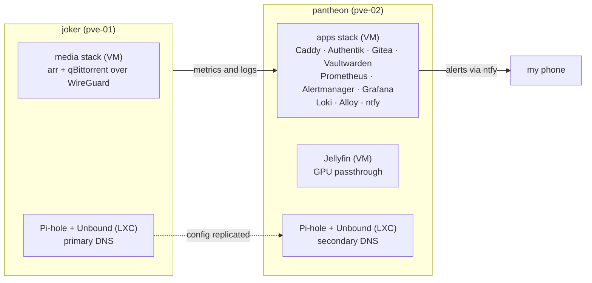

## Blessings Moyo

Junior Linux systems administrator in Northern Virginia. I have administered RHEL
across more than ten client production environments, and I run two Proxmox VE nodes
at home the same way: described in git, monitored, and rebuilt from config rather
than from memory.

Most of what I write lives on a self-hosted Gitea inside the lab, so this profile is
the public slice rather than the whole picture. Happy to walk through any of it.

---

### The lab

Two Proxmox VE nodes, `joker` and `pantheon`, running the workloads I would rather
break at home than at work. Everything that can be a file is a file: Compose stacks,
Caddy config, Prometheus rules, and dashboards.

Storage is ZFS: a mirror for media on `joker`, plus an SSD RAIDZ1 pool for app data
and an HDD RAIDZ1 pool for bulk on `pantheon`. Apps sit behind Caddy with real Let's
Encrypt certs issued over Cloudflare DNS-01, and single sign-on is Authentik via OIDC.
Alerts leave Alertmanager and land on my phone through ntfy.

**[bmoyo413/homelab](https://github.com/bmoyo413/homelab)** is the curated version of
it: the stacks, the DNS build, an incident writeup from the time a host's DHCP lease
moved and Prometheus went on scraping the old address, and an honest list of what is
not done yet.

The lab is under active development. Next up, in roughly this order: the fleet
patching playbook and inventory, Proxmox provisioning in Terraform, verified off-host
backups, and the Tailscale overlay as a defined network instead of hand-rolled port
forwards.

---

### What I work with

| | |
|---|---|
| **Servers** | RHEL, Rocky, CentOS, Ubuntu, Debian, Proxmox VE |
| **Automation** | Ansible, Bash, Git, cron |
| **Containers** | Docker, Docker Compose |
| **Observability** | Prometheus, Grafana, Loki, Alloy, Alertmanager, Nagios, ntfy |
| **Networking** | DNS (Pi-hole + Unbound), Caddy, WireGuard, NFS, TLS, Let's Encrypt |
| **Access** | SSH keys, sudo and RBAC, firewalld, hardening, Authentik SSO (OIDC) |
| **Storage** | ZFS (mirror and RAIDZ1), LVM |
| **CI and IaC** | GitHub Actions, Terraform (Proxmox, Tailscale), Sigstore/Cosign |
| **Ticketing** | osTicket, Jira |
